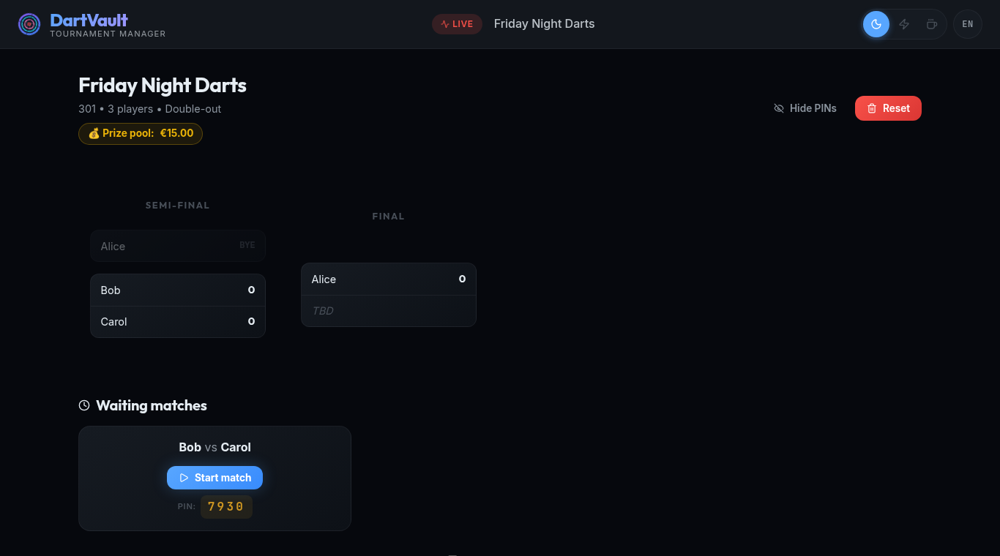
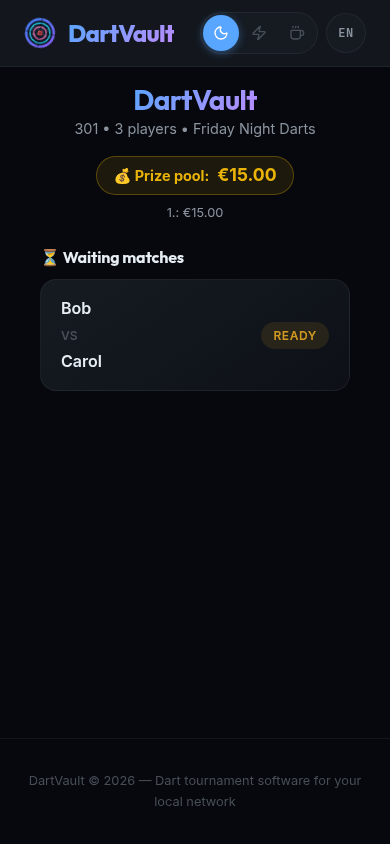
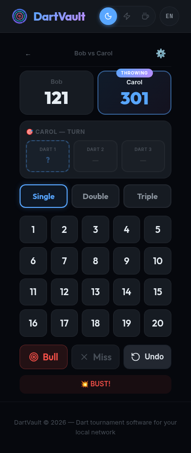
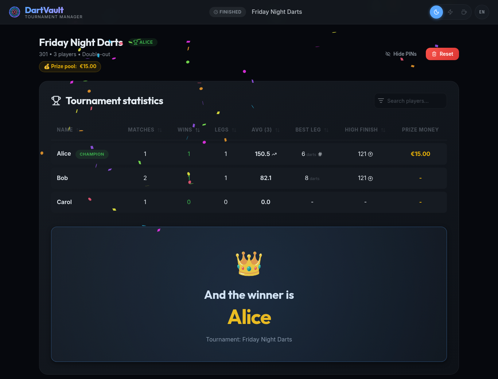

# 🎯 DartVault — Dart Tournament

[](https://github.com/FishMacc/dart-tournament/actions/workflows/ci.yml)
[](LICENSE)


Dart tournament software for your local network. A laptop runs the tournament and shows the bracket and live scores (ideally on a TV or projector). Players enter their darts on their own phones: scan a QR code and go. No app, no account, no internet needed on the day.



<p align="center">
  
  &nbsp;
  
</p>

## Features

- **Games:** 301, 501 and 701, best-of legs, optional double-out
- **Automatic bracket:** single elimination for any number of players, byes included
- **Phone scoring:** players open the scoring pad via QR code, protected by an optional 4-digit match PIN
- **Host controls:** only the host PC (or a device with the admin link) can create, change or reset the tournament and see PINs
- **Live view** for spectators, with bust and checkout detection and finishing suggestions
- **Statistics:** 3-dart average, best leg, highest finish, wins and legs
- **Prize pool:** entry fee with winner-takes-all, 70/30, top-4 or custom payouts
- **English and German:** switch with the `EN`/`DE` button in the header
- **Three themes:** Obsidian, Neon, Classic
- **Crash-safe:** the tournament is saved after every dart and survives a restart



## Quick start

**Requirement:** [Node.js](https://nodejs.org) 18 or newer (LTS recommended).

| System | Start |
|---|---|
| Windows | Double-click `Start-Windows.bat` |
| macOS | Double-click `Start-Mac-Linux.command` (first time: right-click → Open) |
| Linux / terminal | `npm install`, then `npm start` |

The first start installs dependencies and builds the web app (1–2 minutes, needs internet). After that the browser opens `http://localhost:3000` automatically and everything works offline.

The console window shows all addresses:

```
Host (this PC):        http://localhost:3000
Phones (scoring):      http://192.168.x.x:3000/mobile
Admin on other device: http://192.168.x.x:3000/?admin=1a2b3c4d
```

## Running a tournament

1. On the laptop: **Create tournament**, add players, **Start tournament**.
2. Players scan the QR code on the tournament screen with their phone.
3. On the phone: pick your match, enter the **PIN** shown on the host screen, start the match and enter your darts.

Mistyped a dart? **Undo** on the phone. A phone that loses its connection logs back in with its PIN automatically.

The full checklist for tournament day is in [TOURNAMENT_GUIDE.md](TOURNAMENT_GUIDE.md).

## Configuration

Set these environment variables before starting, e.g. `PORT=8080 npm start` (Windows: `set PORT=8080 && npm start`).

| Variable | Default | Purpose |
|---|---|---|
| `PORT` | `3000` | Server port |
| `HOST_IP` | detected | IP used for the QR code and links (set it if the wrong network adapter is picked, e.g. with a VPN) |
| `ADMIN_KEY` | random, stored in `server/data/admin_key.txt` | Key for the admin link |
| `DART_DATA_DIR` | `server/data` | Where the tournament state is saved |
| `NO_BROWSER` | – | Don't open the browser on start |

## Sharing it with someone

`npm run release` builds a portable folder `dist/DartTournament` with the prebuilt app, the server and the start scripts. Zip it and copy it to the tournament PC; it only needs Node.js.

## Development

```bash
npm install          # installs root, server and client
npm run dev          # server (port 3000, auto-reload) + Vite dev server (port 5173)
npm run test:all     # unit tests: server (Vitest) and client (Vitest + Testing Library)
npm run test:e2e     # socket-level end-to-end runs of whole tournaments
npm run test:ui      # browser test: host + phone play a full tournament (Playwright)
npm run build        # build the client into client/dist
npm run release      # portable folder in dist/DartTournament
```

`test:ui` uses Playwright's Chromium (`npx playwright install chromium` once) or any installed Chromium via `CHROMIUM_PATH=/usr/bin/chromium`. With `SCREENSHOT_DIR=shots` it saves a screenshot of every step; the images in `docs/screenshots` come from there.

In dev mode phones reach the app at `http://<LAN-IP>:5173/mobile`.

### Project layout

```
dart-tournament/
├── server/                  # Node.js + Express + Socket.IO
│   ├── src/                 # game logic, bracket, sockets, host authorization
│   └── tests/               # Vitest unit tests + socket e2e scripts
├── client/                  # React 18 + Vite
│   ├── src/i18n.jsx         # English/German texts
│   └── e2e/ui.e2e.mjs       # Playwright browser test
├── scripts/start.mjs        # one-command start (install, build, run, open browser)
├── scripts/build-release.mjs
├── Start-Windows.bat
├── Start-Mac-Linux.command
├── INSTALL.txt              # short guide shipped with the portable release
└── TOURNAMENT_GUIDE.md
```

## Tech stack

Node.js, Express, Socket.IO · React 18, React Router, Vite · Vitest, Testing Library, Playwright

## License

[MIT](LICENSE)
